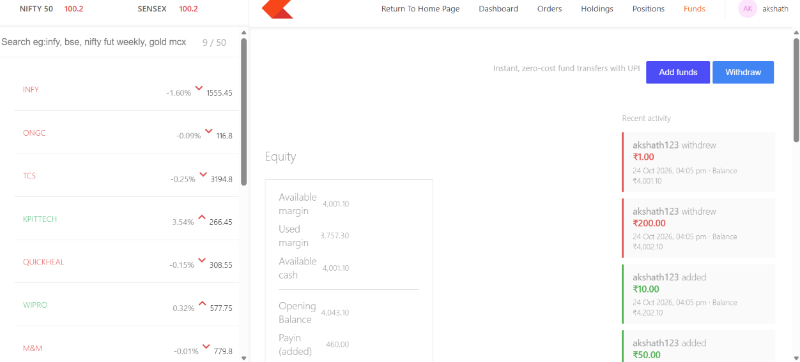
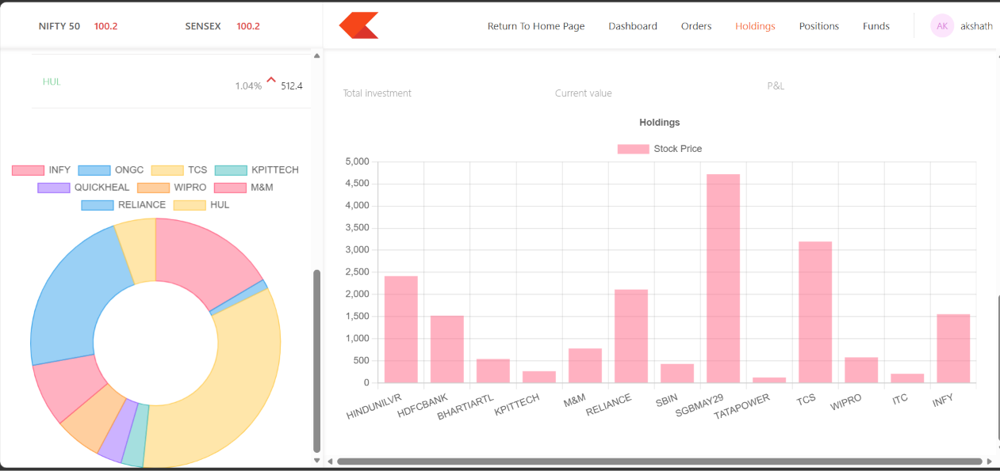
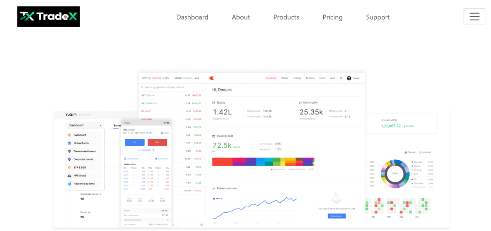

# TradeX

A full-stack stock trading simulator inspired by Zerodha, with a landing page, a trading dashboard and a REST API.


**Live demo:** https://tradex-landing-beta.vercel.app
**Dashboard:** https://tradex-landing-beta.vercel.app/dashboard

> **Try it:** open the dashboard, click **Login / Sign Up**, and enter any username and password. Sign-in is open on purpose so anyone can explore the app without creating an account.
>
> The API runs on Render's free plan, so the first request after a quiet period can take 30 to 60 seconds while the server wakes up.

## Screenshots

### Funds



Signed-in users can add and withdraw money. Every change shows up in the **Recent activity** panel on the right and in the transaction history, labelled with the username of whoever made it. The Equity summary on the left updates straight away. Signed-out visitors don't see the Add funds and Withdraw buttons.

### Holdings



The holdings view lists each position with its quantity, average cost, current value and profit or loss, and summarises total investment, current value and P&L. A bar chart compares stock prices, and a doughnut chart in the watchlist sidebar shows how the watchlist is spread across stocks.

### Landing page



A multi-page marketing site (Home, About, Products, Pricing, Support). The **Dashboard** link in the navbar opens the trading app, and links turn orange on hover and for the page you're on. Inside the dashboard, **Return To Home Page** brings you back.

## Features

- **Sessions:** sign-in creates a JWT stored in an httpOnly cookie, so browser scripts can't read it. The server verifies it on every protected request.
- **Protected actions:** only signed-in users can buy, sell, add funds or withdraw funds. The server checks this on the API itself, not just in the UI.
- **Funds:** add and withdraw money with a transaction history showing which user made each change. A withdrawal can't take the balance below zero, even with simultaneous requests, because the check happens inside a single atomic database update.
- **Orders:** buy and sell orders are validated on the server and saved with the username that placed them.
- **Dashboard:** watchlist, holdings, positions, orders, and an analytics panel with a pie chart that slides up from the bottom.
- **Landing page:** multi-page site with automated tests and a link into the dashboard.

## Tech stack

| Part | Technology |
|---|---|
| Landing page | React, React Router, Bootstrap, Jest, React Testing Library |
| Dashboard | React, React Router, Chart.js, Material UI, Axios |
| Backend | Node.js, Express, Mongoose, JSON Web Tokens |
| Database | MongoDB Atlas |
| Hosting | Vercel (landing page and dashboard), Render (API) |
| CI/CD | GitHub Actions |

## How it fits together

```
Browser
  ├── /            → landing page   (Vercel)
  ├── /dashboard   → dashboard      (Vercel, same site)
  └── /api/*       → forwarded by Vercel to the Express API (Render) → MongoDB Atlas
```

The browser only talks to one address, so the login cookie works without cross-site cookie or CORS problems.

## CI/CD

Every push to `main` runs a GitHub Actions pipeline:

1. **Test and build:** installs dependencies, syntax-checks the backend, runs the landing page tests, and builds the landing page and the dashboard.
2. **Deploy:** only if step 1 passes, builds everything again and deploys it to Vercel as one site.
3. The Render backend is set to deploy only after the CI checks pass.

A failing test blocks the deployment, so a broken change doesn't reach the live site.

## Design decisions

- **One site, two React apps.** The dashboard keeps its own folder and is built under `/dashboard`, then shipped together with the landing page.
- **Vercel proxies `/api` to Render.** This keeps the session cookie first-party and avoids CORS configuration.
- **Atomic withdrawals.** The balance check is part of the update query, not a separate read, so concurrent requests can't overdraw.
- **Open sign-in for the demo.** The first version used username and password with bcrypt. The live demo allows any username so reviewers can try it without registering. The earlier version is in the Git history.

## Run it locally

You need Node.js and a MongoDB Atlas connection string.

1. **Backend**
   ```
   cd backend
   npm install
   ```
   Create `backend/.env`:
   ```
   MONGO_URL=your_mongodb_connection_string
   PORT=3002
   TOKEN_KEY=a_long_random_string
   ```
   Then run `node index.js`.

2. **Landing page** (start this first, it uses port 3000): `cd frontend`, then `npm install` and `npm start`.

3. **Dashboard** (it will offer port 3001, answer yes): `cd dashboard`, then `npm install` and `npm start`.

## Project structure


TradeX/
├── frontend/    landing page
├── dashboard/   trading dashboard
├── backend/     Express API (routes, controllers, models, middleware)
├── docs/        README screenshots
└── .github/workflows/ci-cd.yml


## Known limitations

- Sign-in is open: any username and password works.
- Prices are static sample data, not a live market feed.
- Holdings, orders and funds are shared between all users.
- Buying and selling don't update the funds balance yet.
- Test coverage is limited to the landing page.